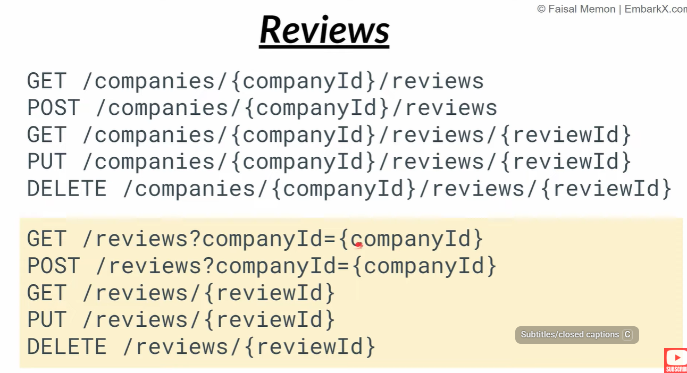

PostgreSQL Driver - client-side software library or plugin that allows applications to communicate with a PostgreSQL database server.
docker run -d --name db -e POSTGRES_PASSWORD=poojita postgres
docker run -d --name pgadmin -e PGADMIN_DEFAULT_EMAIL=admin@admin.com -e PGADMIN_DEFAULT_PASSWORD=poojita dpage/pgadmin4

docker network create my-network
docker run -d --name db --network my-network -e POSTGRES_PASSWORD=poojita postgres
docker run -d --name pgadmin --network my-network -e PGADMIN_DEFAULT_EMAIL=admin@admin.com -e PGADMIN_DEFAULT_PASSWORD=poojita dpage/pgadmin4
docker exec -it pgadmin ping db

Instead of running commands like abve, I created docker-compose.yaml file.
run docker compose up

Login to pgadmin - http://localhost:5050/browser/
Add Required detail to create a server.
create jobapp database

Initially -> monolithic application 8080 port
Transitioning into microservice architecture -> 
company -> 8081 port
Jobs -> 8082 port
Reviews -> 8083 port

APIs for reviews in monolithic application:
http://localhost:8080/companies/2/reviews
http://localhost:8080/companies/1/reviews
http://localhost:8080/companies/1/reviews/1
http://localhost:8080/companies/1/reviews/1
http://localhost:8080/companies/1/reviews/1

Restructuring to microservice:
http://localhost:8083/reviews?companyId=1
http://localhost:8083/reviews?companyId=1
http://localhost:8083/reviews/1
http://localhost:8083/reviews/1
http://localhost:8083/reviews/1

why we need to do this: each microservice should be independent of each other. So getting companyId inside the other services is not good.
We also created each database seperately in pgadmin

We will use RestTemplate for interService communication

servive registry (eureka) = 8761

open feign and resttemplate for microservices synchronous communication

zipkin used for distributed tracing
docker run -d -p 9411:9411 openzipkin/zipkin
http://localhost:9411
